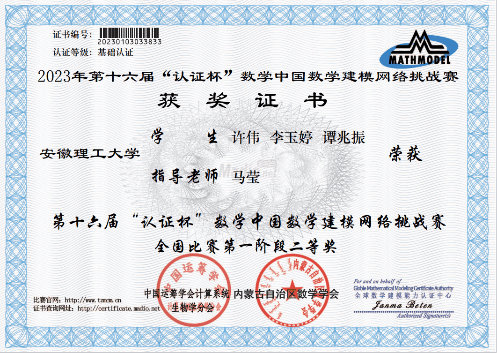
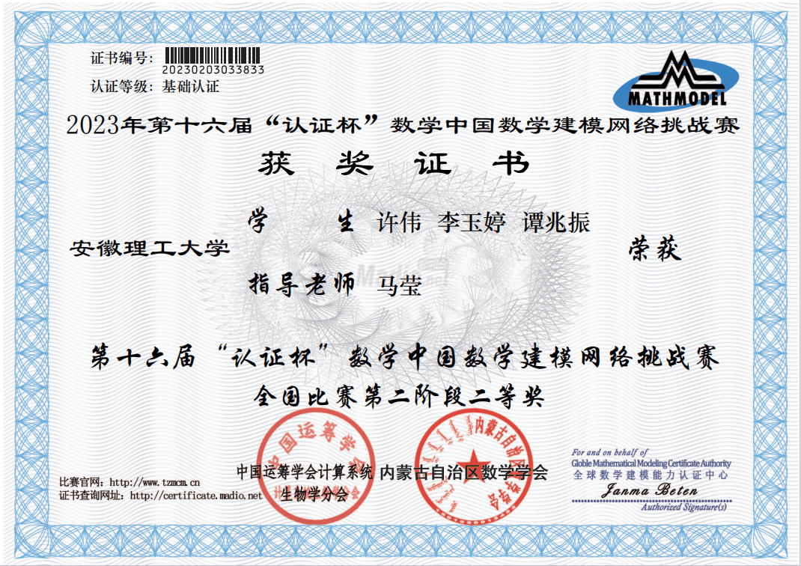
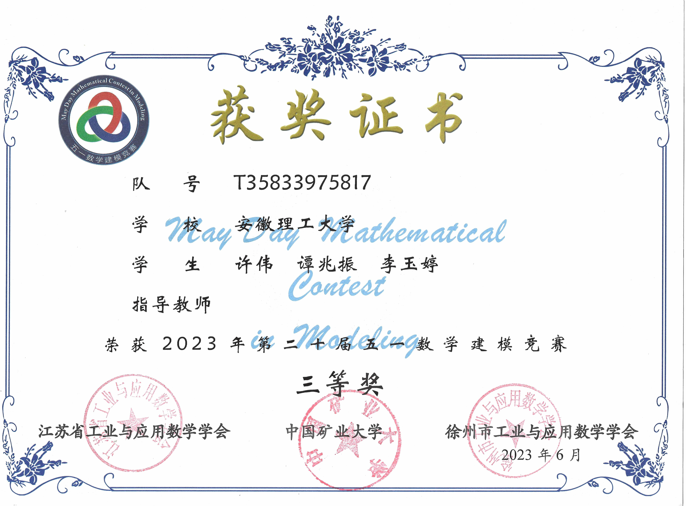
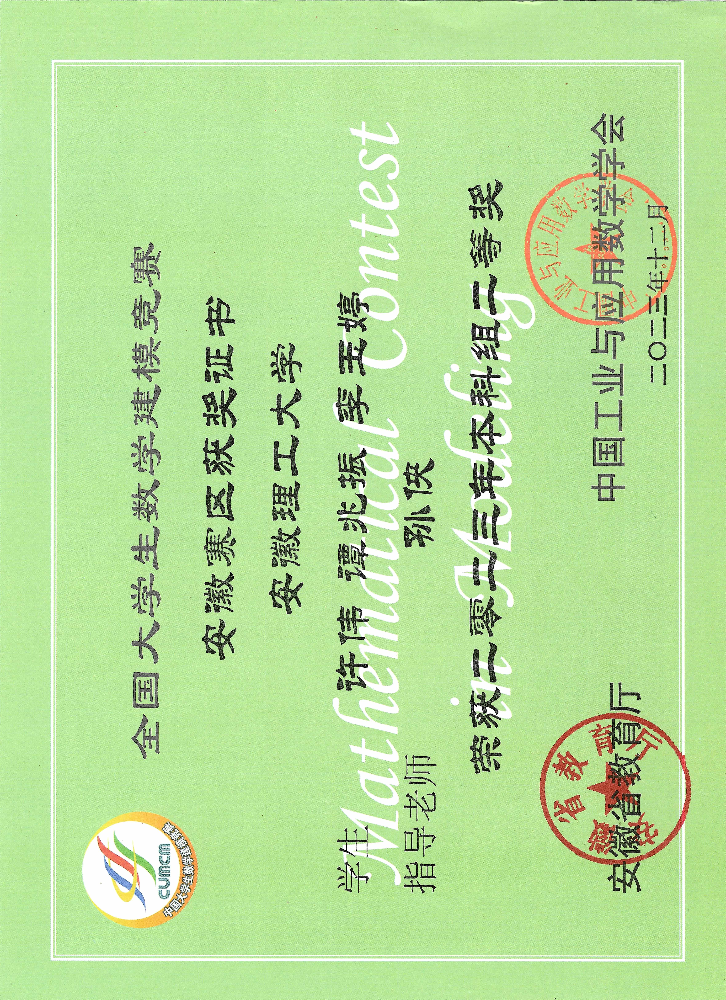
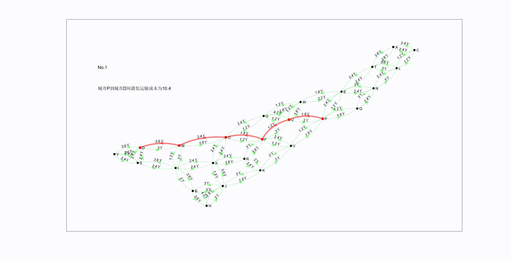

2023 年，海外 OpenAI 与 Anthropic 几乎同时发布大模型产品，GPT-4 与 Claude。Google 先后推出 Bard，并于年底推出 Gemini 1.0。国内市场，百度发布文心一言，阿里巴巴推出 Qwen，智谱 AI 推出 ChatGLM，字节跳动的豆包也相继登场。而那个两年后凭借 DeepSeek-R1 震惊世界的 DeepSeek，在这一年才刚刚成立。这一年 Vibe Coding 词语还未出来，此时打数学建模竞赛的同学，还坚持老传统： Github+CSDN 以及不知名博客网站代码抄袭与修改，在比赛期间知乎 B 站各种社交网站有人打广告，然后跳转如**面包多**/**闲鱼**等网站卖思路。但话说回来，数学建模竞赛是我第一类自主报名的比赛，兴致盎然，心之所向。
度过了大一学年迷茫而懵懂的新手期，进入大二后我开始主动寻找自己的兴趣方向。安理工有个校园活动“仰山社团纳新节”，通常在每年 11 月份于仰山广场举行。遗憾的是，大一刚入学时我还没有意识到自己可以通过参加社团活动来拓展兴趣，因此错过当年的纳新。不过，大二再加入也为时不晚。数学建模协会便是我在这次活动中接触到的社团之一。当时，我在活动现场加入了数学建模社团的 QQ 群。不久 lq 老师也在群里发布了招募信息，介绍自己正在筹备数学建模竞赛，并欢迎有兴趣的同学报名参加。就这样，我顺理成章地加入了数学建模竞赛的 QQ 群。后来，lq 老师从报名的同学中为大家分配队友，我也因此结识了阿 T 和阿 L。两位队友都来自自动化专业，我们三人就这样组成了最初的数学建模竞赛队伍。
2023 年第十六届认证杯数学中国数学建模网络挑战赛（以下简称“==认证杯==”），这个数学建模竞赛是 lq 老师推荐给在 QQ 群第一个比赛，主办单位是内蒙古自治区数学学会。比赛分为两个阶段，两个阶段统一报名，报名费为每队 100 元人民币，3 人组队平均每人约 33.33 元，当然比赛拿奖，学校会发补贴，所以报名费四舍五入等于免费。此外，本次认真杯 lq 老师有在明道楼（力学与光电物理学院）提供一个大教室。第一阶段始于4.13 周四晚上 20 点，结束于 4.16 周日晚上 20 点。晚上八点我们从被挤爆的官网下载试题文件夹，A 题碳板跑鞋，B 题考订文本，C 题心脏危险事件，D 题立体车库的自动调度问题（本题仅限专科组和爱好者组选用）。值得一提的是，两个阶段赛题会延续。那天晚上我们各种讨论，最终选择看起来比较“正常”的 C 题心脏危险事件，随后开始解题。晚上 23 点才回到本科宿舍，此时我了解到我舍友阿 W 也参加本次比赛，然后我们开始激烈讨论，甚至讨论到凌晨 0.30 左右。我了解到在化工学院之外有许多厉害的大佬（什么是大佬？当时我认为就是那些掌握各种我不会技能的同学），当时了解到有使用机器学习的同学尝试之解决 C 题，世界观受到冲击，我一个大二的同学怎么能比得过这种大佬？在匆匆向舍友请教完如何使用 excel 插件方方格子后，我有点小失眠，带着各种复杂情绪进入梦乡。4.14 周五白天我的队友有课，而我在上完一节专业课与实验课后，急匆匆赶到大教室搜索信息。随后两天我们绞尽脑汁，肆意挥霍我们的宝贵大脑，终于在 4.16 离比赛结束一小时前拼凑出文章[基于K-means聚类分析的心脏危险事件的研究](_assets/数学建模竞赛-20261114.pdf)并上交。第二阶段始于 5.18 周四晚上 20 点，结束于 5.21 周日晚上 20 点。我们在第一阶段的基础上改造，拼凑出文章[基于梯度提升算法的心脏事件危险程度的研究](_assets/数学建模竞赛-20261114-1.pdf)。值得一提的是，比赛那两天包括 520 和 521，因此我打趣道别人在过 520 和 521 我们在打==认证杯==数学建模竞赛，笑死。
第一阶段我们的研究思路相对直接，主要采用无监督学习方法探索心律失常数据的分类规律。我们首先利用 Python 对大量 Excel 数据文件进行批量读取，整理和合并，再借助 MATLAB 进行数据可视化，并提取心电功率谱密度数据的偏度，峰度等统计特征。在此基础上，利用 SPSS 中的 K-means 聚类算法，将除正常心搏以外的心律失常数据划分为四类。随后，结合心电波形特征及相关医学文献，尝试将聚类结果与具体心律失常类型建立对应关系。针对不同类型的危险程度，又进一步引入层次分析法（AHP），从心率稳定性、心跳速率和心跳强度三个维度构建评价体系，完成四类心律失常的危险程度排序。客观来看第一阶段的工作，说白了就是把数学建模的基本流程走了一遍：数据处理、提取特征、K-means 聚类，再用 AHP 排个危险程度。流程看着挺完整，但细究起来还是有点糙。K-means 分出来的四类，说到底只是数据上的分组，不能直接当成四种医学诊断；后面硬往具体心律失常类型上靠，多少有点靠文献对号入座的意思。AHP 也是一样，权重多少带点人为判断，最后排出来的危险等级，参考价值有，但没啥用。
第二阶段我们则在第一阶段的基础上进行了方法上的调整，将研究重点转向有监督机器学习。首先，利用随机森林特征重要性分析筛选有效特征，保留偏度和峰度等指标，随后比较决策树、随机森林、GBDT、CatBoost、AdaBoost 等多种分类算法，最终选择梯度提升树（GBDT）建立六级心脏事件危险程度分类模型。论文报告经过参数调整后，模型训练结果的准确率达到 80.9%，精确率达到 81.5%。在此基础上，进一步利用 K-means 对第一级、第四级、第五级和第六级数据进行细分，分别设置 2、4、5、3 个聚类类别，并结合医学文献尝试识别具体的心律失常类型。第二阶段比第一阶段确实更像回事了，不再是单纯 K-means 聚类加 AHP 排序，而是先用 GBDT 判断危险等级，再用 K-means 细分心律失常类型，还比较了多种算法，做了特征筛选和误差分析。不过，模型也不是那么能打，尤其第五、六级的识别效果比较拉胯，分类表现不够均衡。后面聚类出来的类别依旧主要靠统计特征和医学文献去对号入座，缺少独立验证。简单说，框架搭起来了，但距离真正靠谱的医学识别还有云泥之别。
说白了，这两阶段也不是单纯为了凑论文而堆算法，而是围绕同一个问题，一步步摸索着往前走：第一阶段用 K-means 聚类，第二阶段引入 GBDT 做危险等级分类，再进一步细分心律失常类型。虽然现在回头看，特征提取、模型验证和医学解释都有不少不成熟的地方，但好歹把数据处理、算法选择、建模分析这一整套流程完整折腾了一遍，也算是实打实地体验了一次数学建模。有趣的是，==认证杯==两个阶段都还真拿了二等奖。嘻嘻。

第二十届五一数学建模竞赛（以下简称“==五一联赛==”），主办单位是中国矿业大学。这个数学建模竞赛算是我们这个小团队自己选择报名参加的，另外 lq 老师没有提供房间，因此我们三个人合伙在某间教室开干。竞赛时间是4.28 上午10: 00 到 5.1 中午12:00，这个时间刚好卡在放假前夕。4.28 上午 10 点多，我们下载竞赛试题文件夹，其中 A 题无人机定点投放问题，B 题快递需求分析问题（赛后 20240125 有所思考，可以通过 dijkstra 算法解决），C 题“双碳”目标下低碳建筑研究。我们简单讨论过后，认为可能 B 题快递需求分析问题可以编，C 题我们简要查询数据没有详细资料，最后三人投票选择我看来最难的 A 题，无人机定点投放问题，现在我倒是有点疑惑，可能当时有点摆烂了。由于试题选择 A 题无人机定点投放问题，我在互联网寻找各种资料，比如 comsol 官网案例，Github 下载 Matlab 案例代码，Solidwork 模型，然后两个队员绞尽脑汁解题，现在我已经想不出来解题过程，只知道终于在 5.1 上午接近 10 点拼凑出文章[基于数值计算模型的无人机定点投放问题的研究](_assets/数学建模竞赛-20261115.pdf)并提交结束比赛。时隔多年来看这篇文章，这篇文章主要研究无人机定点投放问题，整体思路比较直接。首先，基于牛顿第二定律和空气阻力公式，建立物资下落的运动微分方程，利用 MATLAB 数值计算分析不同风向下的投放距离。随后，将模型拓展到无人机俯冲发射爆炸物的情境，综合考虑飞行高度、速度和俯冲角度等因素，通过优化算法寻找合适的发射策略。最后，引入扩展卡尔曼滤波（EKF）算法，对无人机的滚转角、偏航角及角速度进行状态估计，尝试分析飞行稳定性与命中精度之间的关系。客观来看，文章建模框架还算完整，从基础运动学分析到数值优化，再到 EKF 姿态估计，基本把数学建模的流程走了一遍。不过细究起来，问题还是不少。首先，空气阻力模型前后不够一致，部分公式推导存在问题；其次，计算结果也有明显矛盾，比如飞行高度为 300m，算出的投放直线距离却只有 153.3m，显然不太合理。后面的优化算法也没有交代清楚具体过程，所谓的最优结果缺少充分验证。至于 EKF，本质上只是状态估计算法，不能直接拿估计结果当作最优控制策略。文章的思路是有的，也尝试把微分方程、数值计算和 EKF 结合起来，但多少有点为了完成建模流程而使用算法的感觉。模型建立了，图也画出来了，可数学推导、结果验证和算法之间的衔接还不够扎实。整体算是一次比较完整的数学建模实践，但距离真正严谨、可靠的研究还有不小的差距。嘻嘻，==五一联赛==还真拿了三等奖。

高教社杯全国大学生数学建模竞赛（以下简称“==国赛==”），主办单位是中国工业与应用数学学会。我参加==认证杯==和==五一联赛==，某种意义上其实是练习为==国赛==准备练练手。9.7 晚上18:00 我们下载并打开压缩包，文件里有 A 题定日镜场的优化设计（不会），B 题多波束测线问题（不会），C 题蔬菜类商品的自动定价与补货决策（可以考虑），D 题圈养湖羊的空间利用率（不会），E 题黄河水沙监测数据分析（不太会），简单讨论之后我们投票选择 C 题。然后就是一段惊心动魄的~~编故事~~撰写文章。比赛规则指出 9.7 晚上 18:00 到 9.10 晚上 20:00，参赛队伍撰写论文，生成并上传 MD5 码。这一阶段可以多次上传 MD5 码（也就是修改论文）。9 月 10 日 20:00 到 22:00 ，最多只允许上传一次 MD5 码（注意，MD5 码必须在 20:00 前生成；如果论文文件在此后被打开并保存，MD5 值发生变化，就不能再按正常流程更新）。所以我们大概在 9.10 晚上 17.30 左右结束文章撰写，整理支撑材料啥的，然后开始提交MD5 码。9 月 10 日 22:00 到 9 月 11 日 20:00，上传与此前 MD5 码对应的参赛论文 PDF/Word 文件，以及支撑材料压缩包。我们考虑 9.10 晚上 20 点左右系统可能会卡顿，因此我们提前结束论文撰写，二次上传 MD5 码一次，然后晚上 20 点之后二次上传 MD5 码，22 点卡点进系统上传参赛论文以及支撑材料压缩包。我们绞尽脑汁写出文章[关于蔬菜类商品的自动定价与补货决策分析](_assets/数学建模竞赛-20261115-1.pdf)，最后我们组获得全国大学生数学建模竞赛安徽赛区二等奖。哈哈。

参加这四场数学建模比赛，成果如下：
23 年认证杯第一阶段，C 题，**二等奖**（前 15%）
23 年五一杯，A 题，**三等奖**（前 25%）
23 年认证杯第二阶段，C 题，**二等奖**（前 15%）
23 年数学建模国赛，C 题，**省二**（前 20%）

赛后 20240125 我对==五一联赛== B 题快递需求分析问题有所思考，此题其实可以通过 dijkstra 算法解决部分问题，首先将铁路运输网络转化为带权邻接矩阵，然后独立实现 Dijkstra 最短路径算法，最后批量计算与路径可视化。可视化展示如下。

