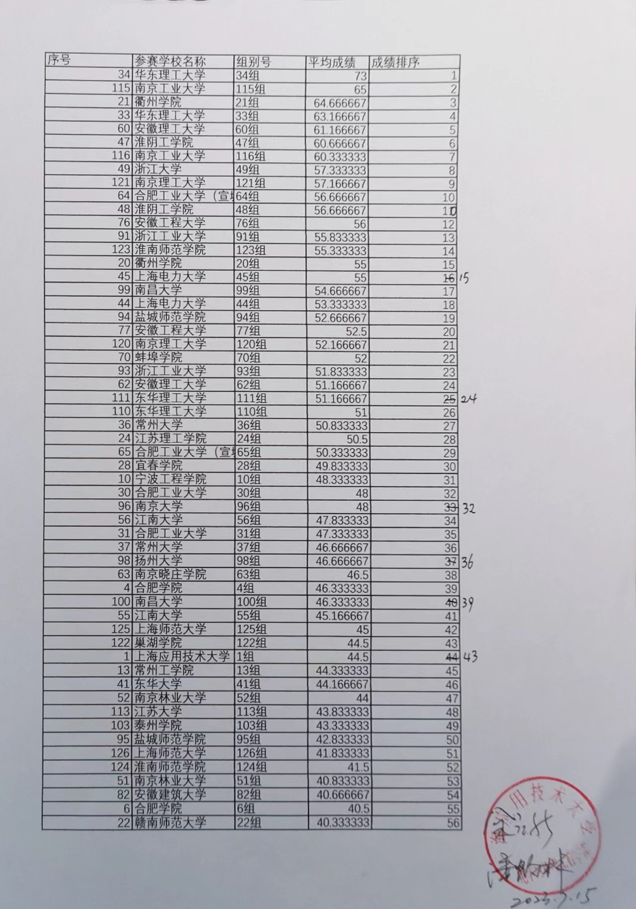
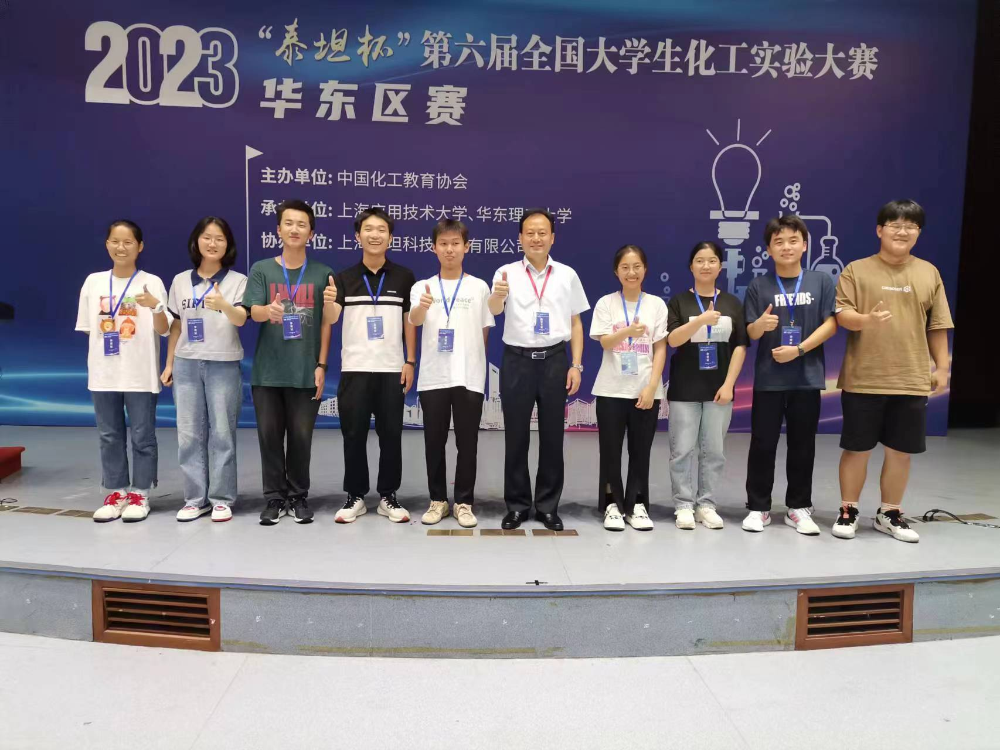
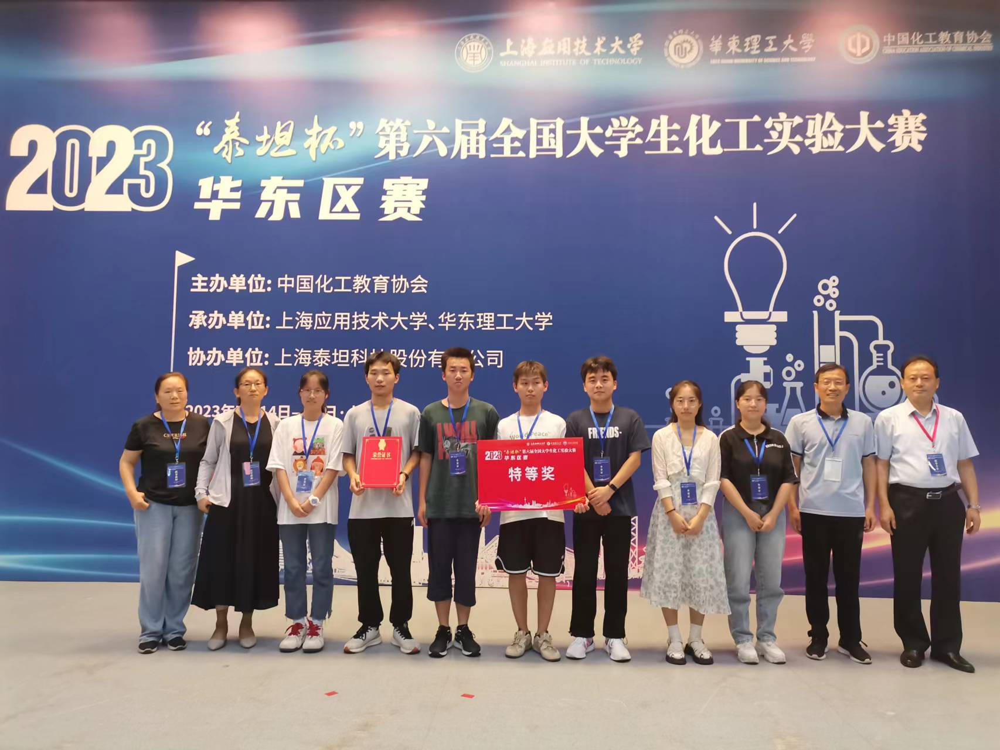
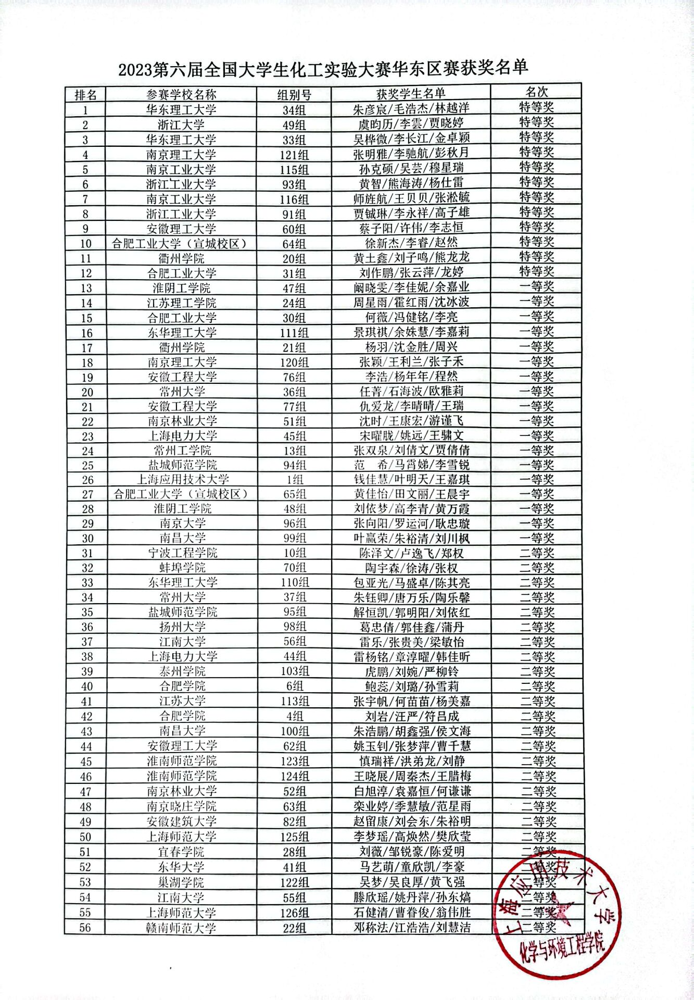
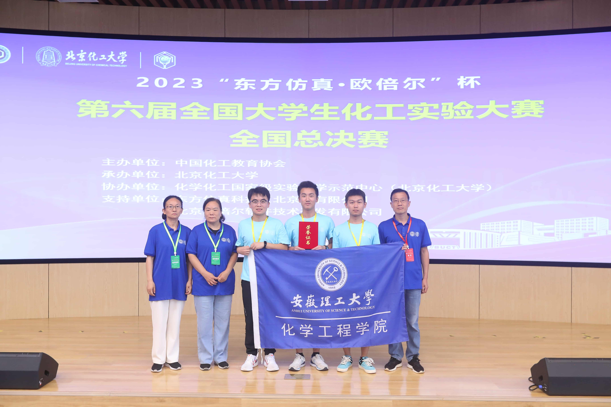

这是我第一次坐地铁，第一次去上海北京，第一次参加大型比赛。
2023 年 3 月初，此时正值化工设计竞赛报名阶段，同专业 wn 与 cl 两位同学在微信上找我组队参加化工实验大赛，这算是我第二次听见化工实验大赛的名头（其实在大二上学期也就是 2022 年 10 月份，化工原料（上）课程讲师首次提到此比赛，我唯一的印象是老师提到笔试分数不高，及格比较低）。当时考虑到化工实验大赛含金量不如化工设计竞赛（教育部认可大学生赛事目录榜单里边，化工实验大赛是 2023 年新增），需要校内选拔以及培训，且可能与化工设计竞赛冲突，因此我并没有把这个比赛放在心上。
6 月 12 日进行校赛选拔，报名参加“2023 年化工实验大赛”的同学共有 30 人（制药工程专业 2021 级 8 人；化学工程专业 2021 级 15 人，应用化学专业 2020 级 7 人）。在经受化工原理课程半年熏陶后，我毅然而然帮忙校赛选拔，理由很简单，学都学了起码得试试。考试那天傍晚，累积三十名同学在某间教室里面奋笔疾书，此时化工原理考试能使用计算器，我拿着 dx 学姐的卡西欧计算器嘎嘎乱杀，结束笔试。笔试后 30 人中选拔出 9 人参赛，值得一提的是其实一个学校最多有两个队伍获得区赛奖，最多一个队伍进国赛。大概阿 C 第一，我第二，阿 L 第三（老师亲口承认特意按照前九名成绩组队）。 
六月上旬至七月上旬，是化工实验大赛集中培训的阶段。说是培训，其实就是把我们九个人拉到制药系某间办公室里集中学习。emmm，这段日子十分单调， 白天我们需要在制药系办公室进行刷题，晚上练习仿真实训，临近比赛前一周开始集中进行化工实验操作训练 。比赛由化工原理理论笔试、化工单元仿真操作和化工原理实验三大赛项组成。
化工原理理论笔试是比赛重点，因为笔试后才能决定参加后续两个项目人选，意思就是说，笔试没到前面名次你是无法参加化工原理实验。因此培训大部时间我们在刷题，刷题也是复习，整个培训周期大概一个月，反复学习内容就是《化工原理》。笔试刷题其实没什么技巧。我们各自先按照《化工原理》的考试复习套路复习一遍，同时去图书馆借阅《化工原理》习题册，按照不同专题逐一刷题。这本身就是一件相当枯燥的事情。有意思的是，虽然我当时刷题不多，但后来在上海参加华东区赛笔试时，恰好遇到一道流体流动的题目。虽然不是原题，但解题思路几乎一模一样。首先，往届考试题目没有流出，当然安理工有一年承办华东区赛因此有当年笔试影印版试卷试试水。此外，官方群里边有人发出第一届笔试试卷 PDF，理由是不公布试题涉嫌不公平竞争，这类趣事自然忘得差不多了。其次，带队老师会来到自习室帮助我们，其实就是看看有哪些题目不会写，然后交流一下思路。
化工单元仿真操作是死记硬背的一段时光。其中考试内容包括工程型化工单元操作仿真及验证型化工原理实验仿真两部分。工程型化工单元操作仿真考试由东方仿真提供，包括 HAZOP 分析（必考）与化工传质单元操作（吸收/精馏，二抽一）。验证型化工原理实验仿真考试由欧倍尔提供，包括化工原理实验室安全演练（必考）、实验 3D 仿真（液-液萃取实验 3D 仿真/恒压过滤实验 3D 仿真/流化床干燥实验 3D 仿真，三抽一）。值得一提的是，这两类软件教学通过抖音，于六月中旬直播培训，我在直播间抽到 HAZOP 分析书籍一份，然后就是酷酷刷操作步骤。两类软件必考题相对简单，我们可以提前刷到接近满分，但抽考题如化工传质单元操作（吸收/精馏）是无法完全刷会的，因为这种题目（比如精馏）需要选手对工况界面进行实时操作才能得分，因此假如开头精馏塔压力爆了没泄压，我们大概率得 5 分。面对这种连续性操作工况题，我们在万能学习平台 B 站找到相关视频逐帧分析学习，最后我们完全学会精馏几乎满分（95-98分，按照精馏塔馏出物纯度记分），而吸收基本上没有怎么认真学（没时间）。这种工况题目由于是模仿精馏塔开车停车，进行所有得分点操作需要 1h。实验 3D 仿真我们基本上都学到拿满分的程度，毕竟实验 3D 仿真（液-液萃取实验 3D 仿真/恒压过滤实验 3D 仿真/流化床干燥实验 3D 仿真，三抽一）可以完全记忆下来操作要点。
化工原理实验考试范围包括流体流动综合、传热综合、精馏、吸收四个实验项目。实验学习这方面拉完了，我们在华东区赛大约前一周进行集中学习，带队老师以我们在化工原理实验课已经完成学习操作为理由默认我们已经熟练操作实验步骤，实际上我由于偷懒经常让我的舍友阿 W 代替我操作，很多细节我不太会。另一方面本次比赛是在华东理工大学化工学院实验室进行，于是老师概括性的讲述这几类实验要点，我迷迷糊糊的听。由于化工实验大赛和化工设计竞赛档期相当接近（前者华东赛区决赛 7 月 15 日—17 日于上海应用技术大学举办，华理协办提供实验设备，全国总决赛 2023 年 8 月 10 日—13 日于北京化工大学举办。后者华中赛区决赛 2023 年 8 月 1 日—4 日于江西九江学院举办），晚上熬夜加班是经常的事情（ 7 月 6 日凌晨队友阿 C 电脑黑屏出问题，文件未保存未汇总，我联系我仅有的电脑高手阿 Z 进行腾讯会议指导），且白天在制药休息室刷题的时候空调温度对我而言有点低。意料之外情理之中 7 月 10 日早上我就感觉不太对劲，头脑昏沉，刷题有点勉强。中午我和队友在食堂聊天，聊到化工设计与化工实验冲突以及我生病时，我说出那句至今我认为离谱的言论：累死也给你干到区赛二等奖。我勉强撑到下午听完带队老师讲完传热实验后，我前往校医院抽血化验，诊断为急性上呼概通感染，说人话就是我发高烧（39 ℃）。那天晚上我好好休息之后，第二天感觉好了不少，我随身夹着温度计时刻记录体温，从 38.9℃一直慢慢降到正常体温 37.5℃，这离不开医院开的药以及我按时睡大觉没有熬夜干活。总之这次赛前一周发大烧大概在 3-5 天内结束，我们在迷茫中囫囵吞枣似的刷题，练习仿真操作，以及抽象理解实验操作。
7 月 15 日是比赛正式开始的日子，我们于 7 月 14 日早上 7 点出发，从合肥南站转高铁前往上海虹桥站，转地铁，转公交车前往偏僻的上海应用技术大学奉贤校区。中午 11 点转地铁的时候，可能是因为我第一次坐地铁新奇感，我拿着陪伴我走过高考考场的身份证落在地铁上边了。我后背发凉，因为笔试需要检查身份证。带队老师安慰我，队友没说啥，我有点尴尬。公交车把我们（9 名选手+3 名带队老师）送到酒店，由于我只有身份证照片没有实体身份证的缘故，我一个人住（其实本来就是 9 人，其中男生五名，女生四名），倒也有几分安静。下午 14 点我们在岚庭宜尚酒店安顿好，带队老师陪我前往海湾派出所办理临时身份证，单程 2.4 km，途中经过上海师范大学，上海应用技术大学，最后到达海湾派出所，被工作人员告知非上海人不能办理临时身份证，于是两个人灰溜溜返程，下午 16 点回到酒店。晚上去上海应用技术大学简单吃晚餐之后，大家就留在酒店复习第二天笔试。
7.15 上午八点召开动员会，随后进行合影。九点正式开始笔试。由于我的身份证遗失，带队老师便通过 QQ 群向组委会咨询，得到的答复是我可以出示学生证作为身份证明。随后就是为期两个小时的无聊笔试，由于前期一个多月的复习主要围绕笔试展开，对笔试这关我可谓是得心应手，不出意料顺利通过。虽然暂未出笔试成绩，下午我们十二人一齐前坐班车往华东理工大学化工学院实验室去熟悉实验装置，折腾到下午五点，坐班车回上海应用技术大学食堂吃晚餐（有餐券），然后就是散步回校外酒店。期待的心大约折腾到晚上 19 点，笔试成绩出了，我们队拿到华东区赛第五名好成绩，笔试平均分 61.16，哇塞，当时那个激动的心，一伙人折腾到凌晨（复习实验操作与仿真操作），我才去睡觉。期间抽签决定实验与仿真先后（华理进行实验考试，上海应用技术大学进行仿真考试，因此需要抽签决定考试先后），我们队是第二天上午实验，下午仿真。

7.16 早上六点吃过早餐，我们坐班车去华理进行实验考试，这里现场抽签到流体流动综合实验，我们原以为是最简单的实验，结果实验从上午 8:30 持续到中午12:00，我们在开阀门这个步骤上丢失大量时间，赛后反思：我们做实验太少了，开阀都不太了解。好在最终急急忙忙大概做完实验，记录完数据（我印象里实验没做完，数据点没取够），实验报告写得差不多，最终在中午 12 点前上交实验报告。印象中此次操作完成度较低，得分不高。仿真操作在上海应用技术大学，我们从华理坐班车直达考点，并在考点吃盒饭午休。下午 14:00-17:00 进行仿真考试，长达三个小时的考试中我们需要完成各项仿真考试，且日常练习中我们是打开倍速跳过漫长的等待期，而考试中我们只能干等，我看到其他学校的同学似乎没有我们准备得充分。晚上我们同样在上海应用技术大学食堂吃晚餐，然后回到酒店静候佳音，晚上只听说安理工有队进国赛，哇塞，我们激动的不得了。
7.17 上午开会公布区赛结果，我们队拿到区赛特等奖并进入国赛，我们一起合照记录此时高光时刻。当天晚上 17.00 我们便返程回到学校。

八月初 1-5 号经历化工设计竞赛后，我们紧急复习温故这套流程，决赛定于北京化工大学 8 月 11 日-13 日举行，我们复习时间不到一周（实际只有五天不到，因为 8.6 之前我们在紧急备战化工设计竞赛华中区赛），同样是粗糙复习笔试，实验操作和仿真操作，然后进京赶考。8.10 带队老师再次领着我们，从淮南东站出发前往北京南站，转地铁转公交到达中国石油科技交流中心入住。8.11 上午进行机试，下午仿真考试。8.12 上午进行实验考试，本次实验我们再次抽到流体流动综合实验，由于上次赛后我们紧急复盘，本次实验一切流畅。8.11下午我们没有精力折腾，从昌平区前往天安门啥的，毕竟时间又短，校区又偏僻，我们在宿舍躺平玩手机。晚上聚集吃大餐。8.13 早上坐班车前往北化的同时，我们得知笔试平均分 44。上午开会我们得知结果，拿到第六届全国大学生化工实验大赛全国一等奖，这是一份美好的礼物。

最后展示结果：我们团队获得华东区赛特等奖，全国总决赛一等奖的成绩。

202611072129 写于北洋园格园二斋 128
