化工设计竞赛，这五字比赛贯穿我大一大二生涯。这段经历我的评价是，简短而又难忘，奇幻而又精彩，奠定并加深我对化工的痛苦认知印象。其主要原因我认为是主观上需要从高中被动学习转化为主动学习，以及在无人授课前提下大量试错，反馈周期长且回报收益不高。
大一上学期体育课我抢到网球课🎾，在引体向上测试时，意外结识一位制药工程专业的同学（下面简称阿 K），他说他来自安徽阜阳。在课程学习时，这位制药工程同学依旧与我们化工同在无机化学与分析化学这门课上，因此我们保持一定联系。
大一生活过得很快，在大二上学期秋天，出于对我绩点排名靠前的缘故阿 K 邀请我加入化工设计竞赛队伍。此时我从未参加任何团体类比赛，出于好奇我理所应当同意。阿 K 向我引荐队长（简称阿 C）。阿 C 给我的第一印象是沉默，此人很会画饼，他向我讲述参加此次比赛的高受益与低风险（本次比赛只要出校赛就可以保底拿国二，而且参加此类比赛的同学不多竞争较小），我十分向往比赛结果（主要是 阿 C 已经有相当的领导能力与规划能力，特别是他画饼又香又大）于是果断答应。协议达成，阿 C 指挥我先行下载化工流程模拟软件 Aspen，然后大二寒假开始准备。竞赛题目一般在来年三月才会公布,但是每年 1-2 月份也就是提前一两个月，内部消息就会流传出来。寒假阿 C 便给我转发截图，竞赛题目暂时确定为己二腈绿色生产。
二月底大学生化工设计竞赛官方网址发布竞赛题目，确认 2023 年全国大学生化工设计竞赛以“己二腈的清洁生产”为题，同时开启报名链接，实时报名名单里有大三同学的名字，我有点不敢相信。原因很简单，其他队伍有大三保研选手团队。按理说化工设计竞赛在化工专业属于那种数一数二的专业级竞赛，但是我们属于大二学生，除了主动了解学生之外（比如阿 C），这种信息差大家都不知道。其次我认为大三保研选手都很厉害，我们表面上看是大二选手比较菜，我们这组队友都不是传统意义上的好学生，除我绩点排名靠前，其他人都是普普通通甚至挂科。
大二下学期的比赛准备很艰难，首先是课程学习我需要刷高 GPA，其次我最开始不相信会出校赛，因此我额外其他比赛，导致我没有特别多时间去精心做化工设计的任务。
在 2023 年“天正设计杯”第十七届全国大学生化工设计竞赛中，我们团队围绕河南神马集团年产 5 万吨己二腈项目，开展了化工工艺流程设计及相关工程设计工作。这张图便是阿 C 在寒假期间初步跑通 Aspen 流程后，以最初的设计雏形为基础，经过一次次模拟、调试与优化，最终打磨出的竞赛作品提交版本。
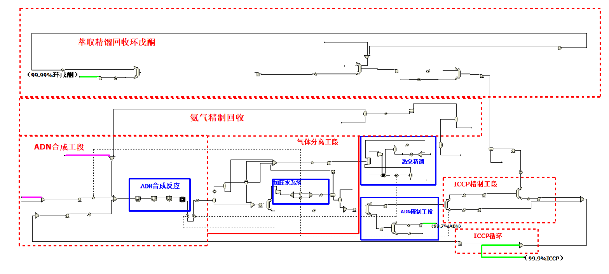
我的任务是设备设计与选型，图纸绘制与经济分析，主要包括：换热器选型设计，设备强度校核，精馏塔水力学校核，设备工艺条件图绘制，设备装配图绘制，泵选型，经济分析。我需要对任务对应的文档进行编撰（就是按照往届作品慢慢修改），如设备设计及选型说明书。
下面这张图片，是我使用 Aspen EDR V11 进行换热器校核得到的结果。
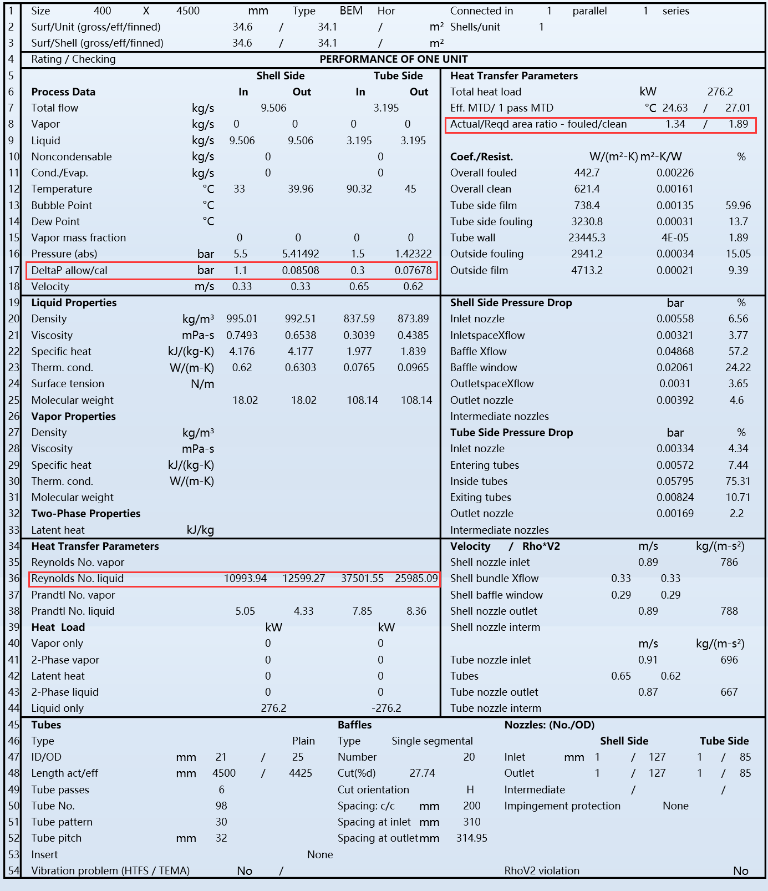
下面这张图片，是我使用 Aspen Plus V11 进行精馏塔塔内件水力学校核，最后得到的水力学操作图。
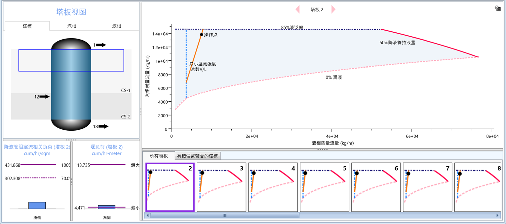
以及经济分析中，项目财务现金流量与年限图。
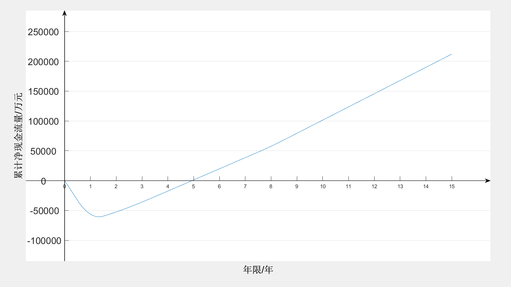
我的工作是 AutoCAD 图纸绘制，这份工作对我来说很难，因为我只在大一下学期学了半学年的 AutoCAD 绘制，我甚至不会图层管理。我的解决办法是，以国特作品为基底，直接删除他们的所有绘图然后我慢慢画，在这个过程中，我画了设备工艺图与设备装配图等（反应器，精馏塔与换热器展示），如下图所示。
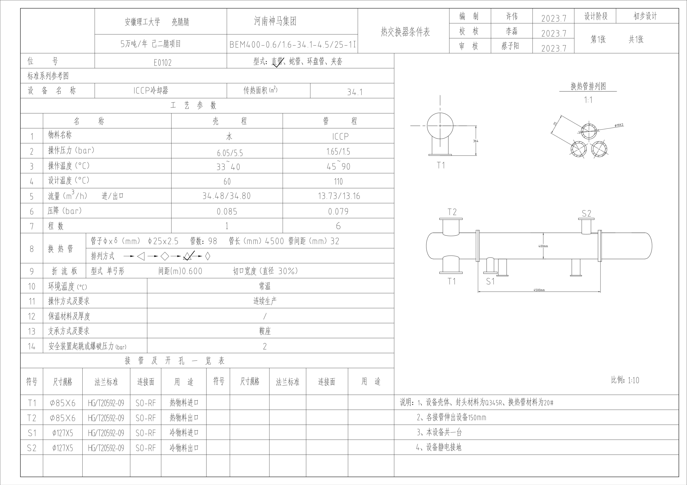
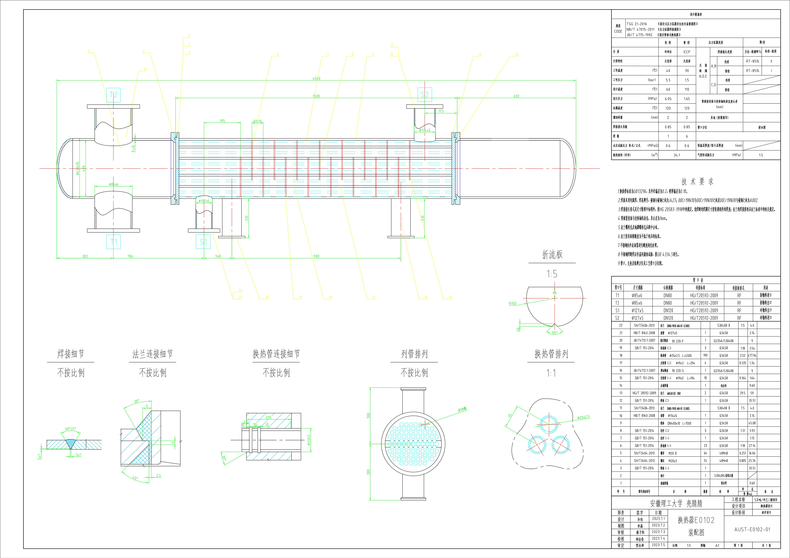
顺带着展示一下队友的成果：
精制塔 DCS 控制系统
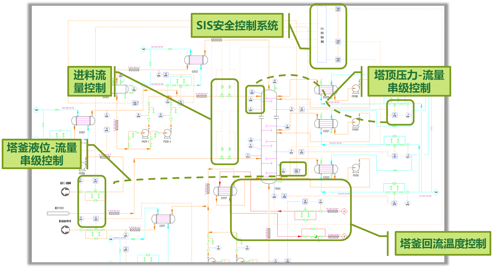
厂区车间三维图
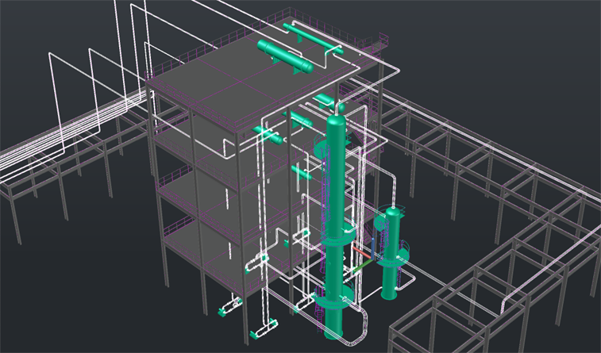
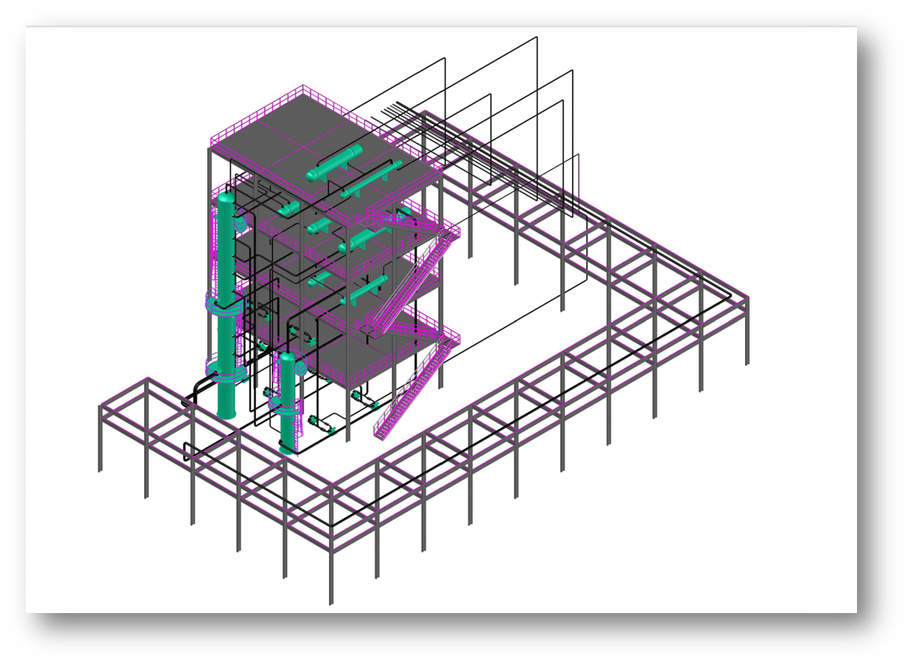
厂区布置图
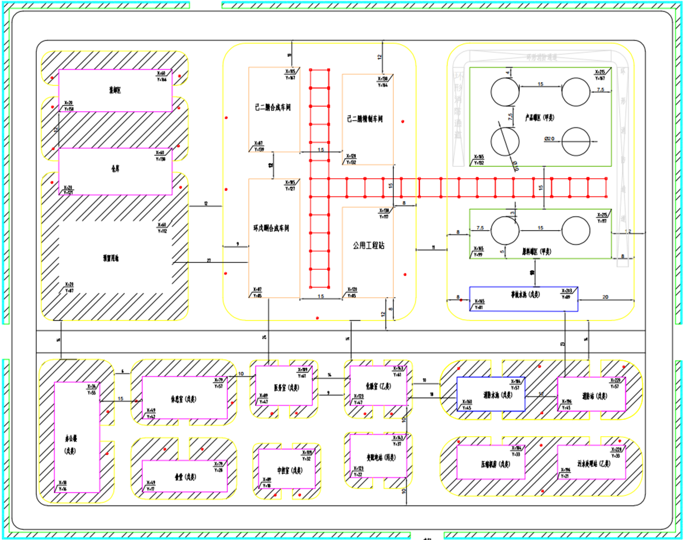
厂区三维布置图
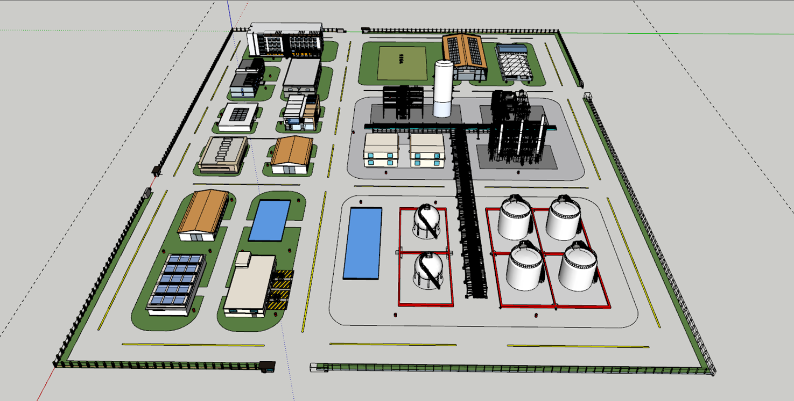
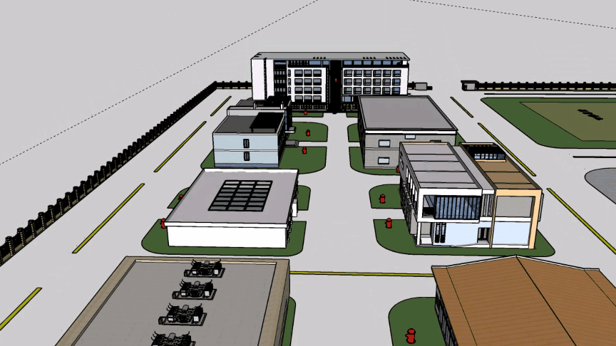
四月五月我参加了三次数学建模竞赛，六月参加化工实验大赛校内选拔赛，月底参加专题培训，时间过得很快，不知不觉就到了七月。7.20 是华中赛区提交作品截止期，我们在化工实验大赛华东区赛结束后，紧赶慢赶终于在 7.18 下午提交作品。七月底，评委初审给出华中赛区校赛结果，我们团队成为安理工校赛第一，成功出圈，按阿 C 画出的大饼，我们可以保底国二。九江之旅迫在眉睫，我们刚刚在上海结束化工实验大赛华东区赛，精力憔悴之余还得对付化工设计竞赛，制作团队展板。八月初，我们团队在九江学院参加本次化工设计竞赛华中赛区答辩，我表现比较并比较差，在最终答辩时刻没有吱声，仅有阿 C 舌战群儒答而不辩。最终稳拿国二结束本次比赛，值得一提的是，比赛期间我们在得知晋级国赛无望之后组团前去爬庐山，倒是别有一番风味。
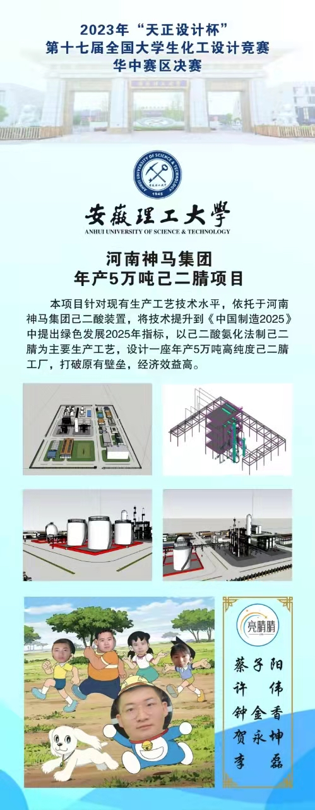
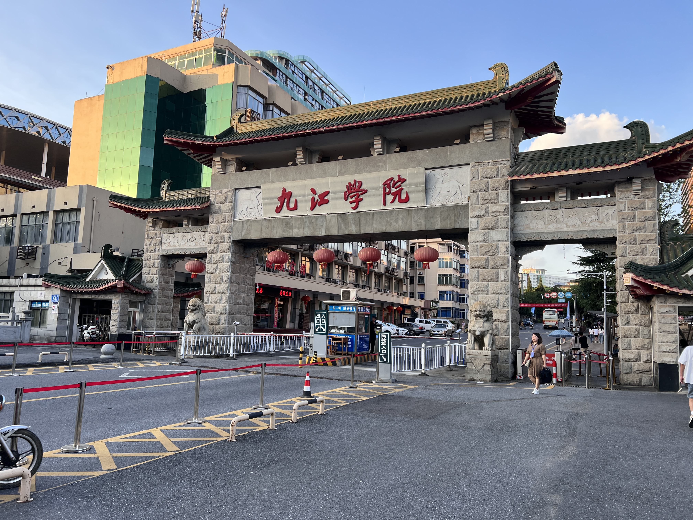
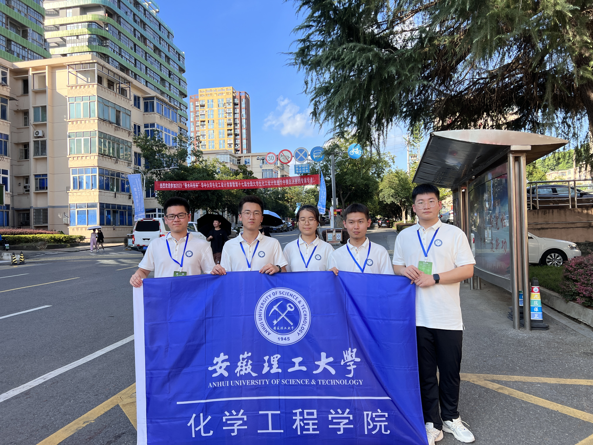
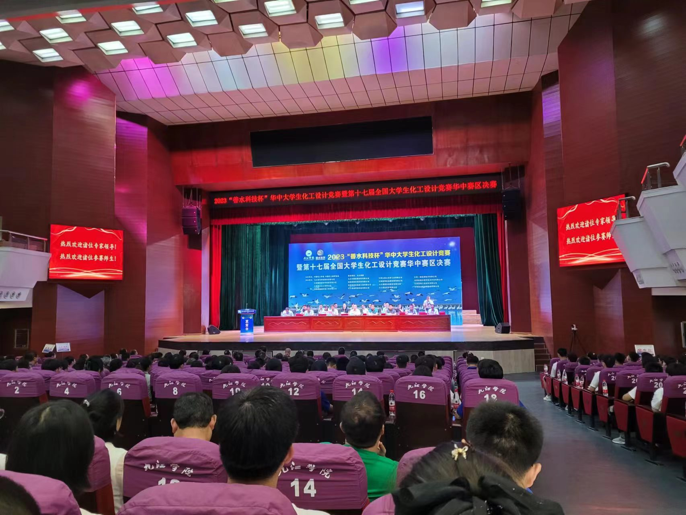
最后展示结果：我们团队获得全国二等奖的成绩。
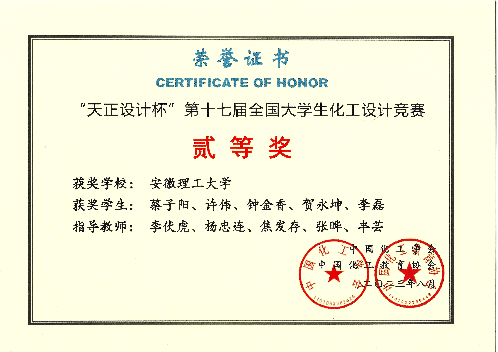

202610310946 写于北洋园格园二斋 128
