化工设计竞赛，这五个字贯穿了我的大一大二生涯。回顾这段经历，我的评价是：短暂而难忘，奇幻而精彩，却也让我对化工有了更深刻、更痛苦的认知。究其原因，一方面是主观上需要完成从高中被动学习到大学主动学习的转变；另一方面是在缺乏系统授课和指导的情况下，只能依靠大量试错来摸索前进。学习过程漫长，反馈周期较长，而阶段性成果和正向回报却并不显著。
大一上学期，我选上网球课🎾。在大学生体测引体向上测试中，我意外结识了一位制药工程专业的同学（简称阿 K），他来自安徽阜阳。由于制药工程与化工专业在课程安排上有一定重合，我们在课程《无机化学与分析化学》重逢，因此我俩保持着一定的联系。
大一的生活转瞬即逝。到了大二上学期的秋天，阿 K 邀请我加入化工设计竞赛队伍，原因是我的绩点排名比较靠前。此前我从未参加过任何专业竞赛，出于好奇，便欣然答应。随后，阿 K 向我引荐了队长（下文简称阿 C）。阿 C 给我的第一印象是沉默寡言，但此人颇有领导能力，也很擅长「画饼」。他向我描绘参加比赛的高收益与低风险：只要通过校赛，基本就能保底获得全国二等奖；而且校内参加此类竞赛的队伍不多，竞争相对较小。也就是说我们的主要对手是校内选手，至于校外竞争那另说。这番描述让我颇为向往。尤其是阿 C 已经展现出相当不错的领导能力和规划能力，再加上他描绘的前景实在诱人，我几乎没有犹豫，便答应加入。至此，双方达成共识。随后，阿 C 安排我先行下载并熟悉化工流程模拟软件 Aspen，计划从大二寒假开始正式准备。化工设计竞赛的题目通常在次年三月正式公布，但每年一至二月，往往就会有一些内部消息提前流传。寒假期间，阿 C 便向我转发了一张相关截图，初步消息显示，当年的竞赛题目可能是**己二腈绿色生产**。
二月底，大学生化工设计竞赛官方网站正式公布了当年的竞赛题目，并开放报名通道。至此，确认 2023 年全国大学生化工设计竞赛的主题为 **「己二腈的清洁生产」**。查看实时更新的报名名单时，我意外发现校内出现由大二大三化工类专业学生组成的 9 支队伍，一时间有些难以置信。原因很简单：某队伍中有大三保研选手。在我当时的认知中，化工设计竞赛算得上化工专业含金量较高，影响力较大的专业竞赛。然而，我们当时还只是大二学生，对这类竞赛的了解相当有限。除了阿 C 这样主动搜集竞赛信息的人，大多数同学甚至不知道还有这些信息渠道，更谈不上提前准备。这实际上反映出了一定的信息差。另一方面，我对大三保研选手多少有些敬畏，潜意识里认为他们都相当厉害。反观我们自己的队伍，似乎并不具备什么竞争优势。除我之外，其他队员的成绩都比较普通，甚至还有挂科的情况。严格来说，我们并不是一支传统意义上的 **「学霸团队」**。
大二下学期，竞赛准备过程相当艰难。一方面，我需要兼顾课程学习，努力提高 GPA；另一方面，由于最初并不认为我们能够顺利通过校赛，我对竞赛的重视程度也不够，因此还额外参加了其他比赛，进一步压缩了用于化工设计的时间。客观来说，那段时间我并没有投入足够的精力去打磨化工设计竞赛的各项任务。
在 2023 年「天正设计杯」第十七届全国大学生化工设计竞赛中，我们团队围绕河南神马集团年产 5 万吨己二腈项目，开展了化工工艺流程设计及相关工程设计工作。这张图展示的便是最终提交的竞赛作品。寒假期间，阿 C 已经初步跑通了 Aspen 流程，随后我们以这一最初的设计雏形为基础，经过一轮又一轮的模拟、调试与优化，逐步完善设计方案，最终形成了提交版本。
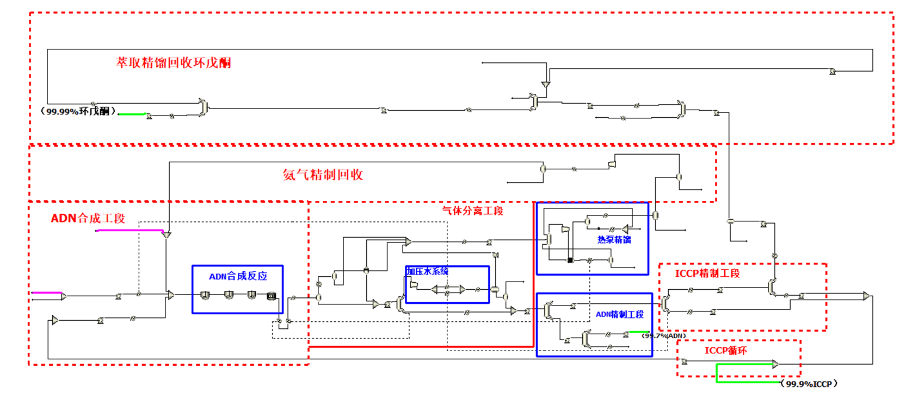
我的任务是设备设计与选型，图纸绘制与经济分析，主要包括：换热器选型设计，设备强度校核，精馏塔水力学校核，设备工艺条件图绘制，设备装配图绘制，泵选型，经济分析。我需要对任务对应的文档进行编撰（就是按照往届作品慢慢修改），如设备设计及选型说明书。
下面这张图片，是我使用 Aspen EDR V11 进行换热器校核得到的结果。
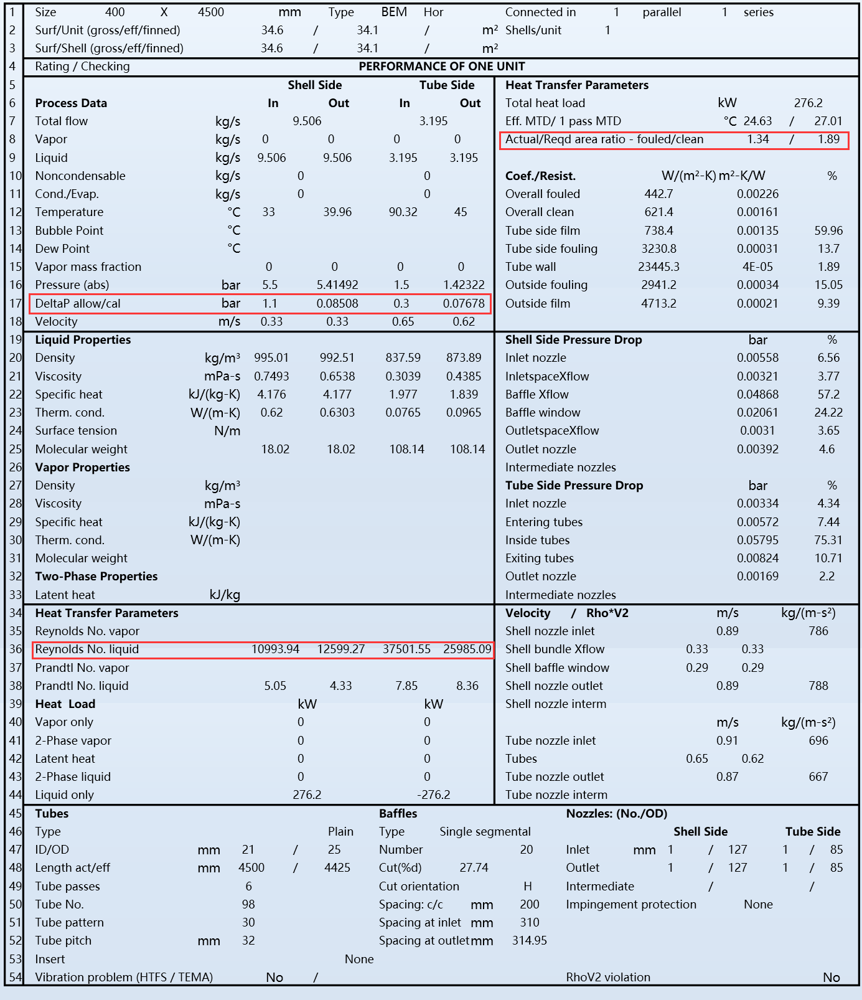
下面这张图片，是我使用 Aspen Plus V11 进行精馏塔塔内件水力学校核，最后得到的水力学操作图。
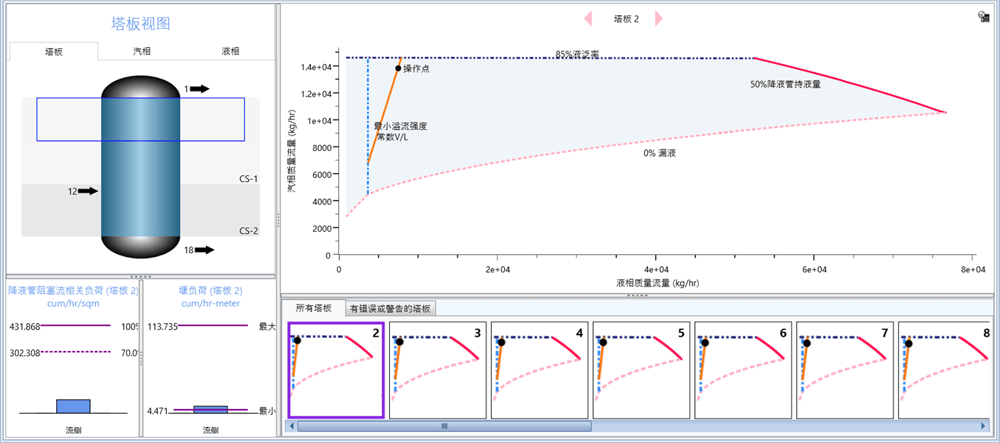
以及经济分析中，项目财务现金流量与年限图。
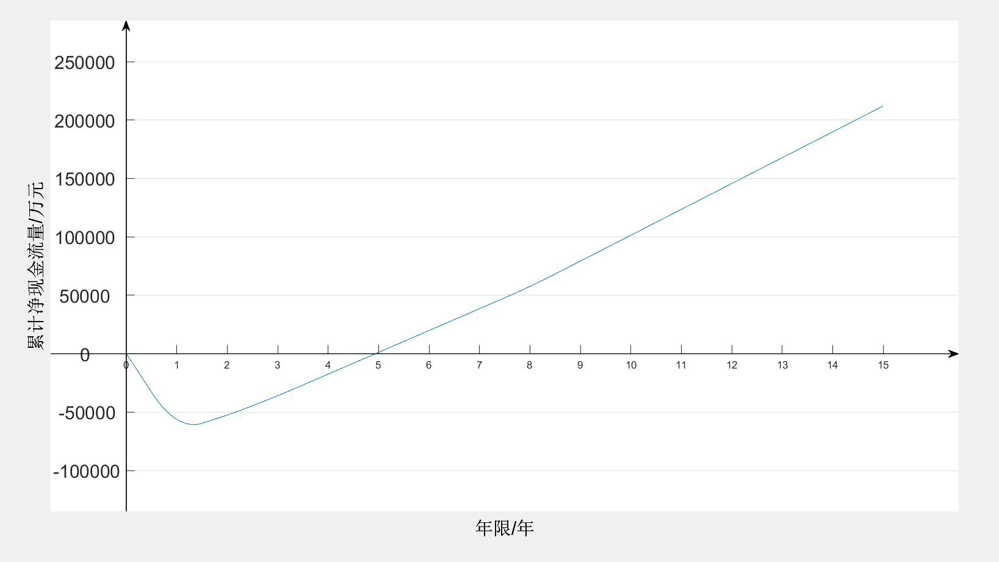
我的工作是 AutoCAD 图纸绘制，这份工作对我来说很难，因为我只在大一下学期学了半学年的 AutoCAD 绘制，我甚至不会图层管理。我的解决办法是，以国特作品为基底，直接删除他们的所有绘图然后我慢慢画，在这个过程中，我画了设备工艺图与设备装配图等（反应器，精馏塔与换热器展示），如下图所示。
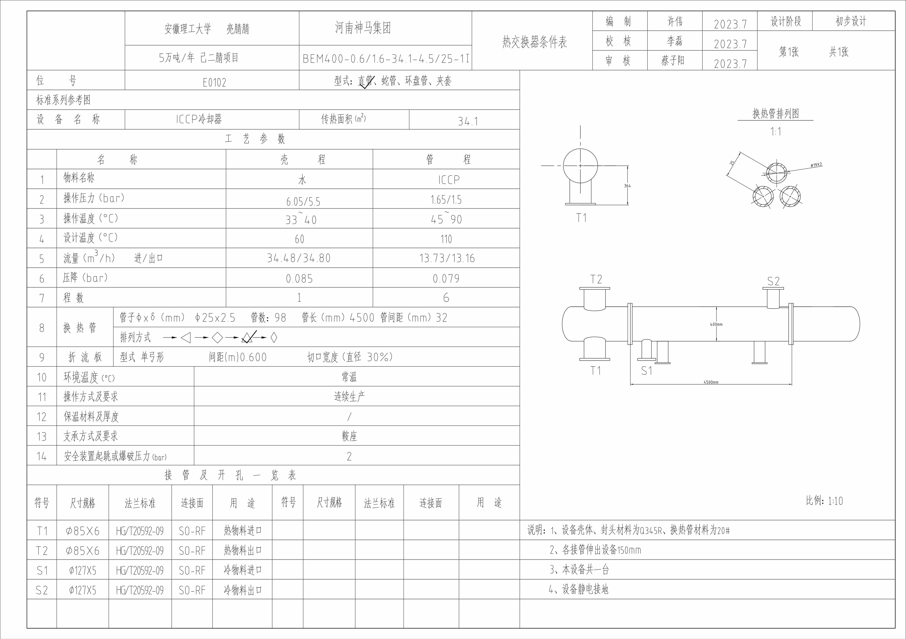
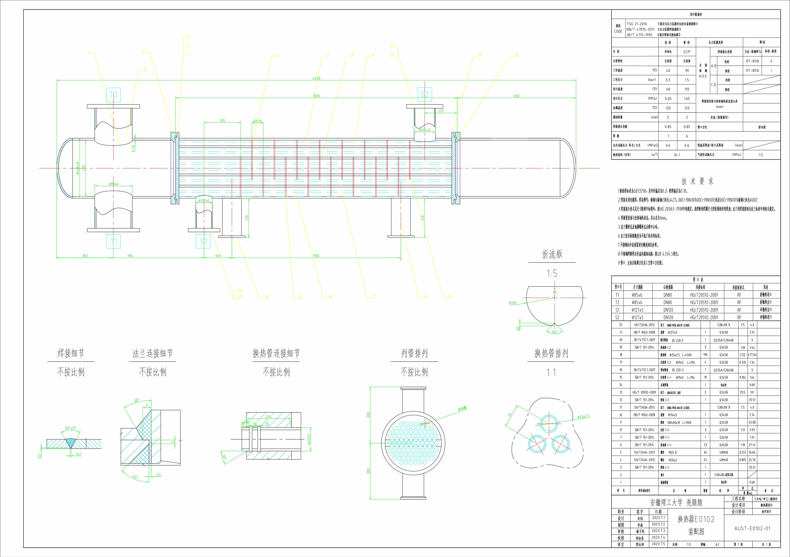
顺带着展示一下队友的成果：
精制塔 DCS 控制系统
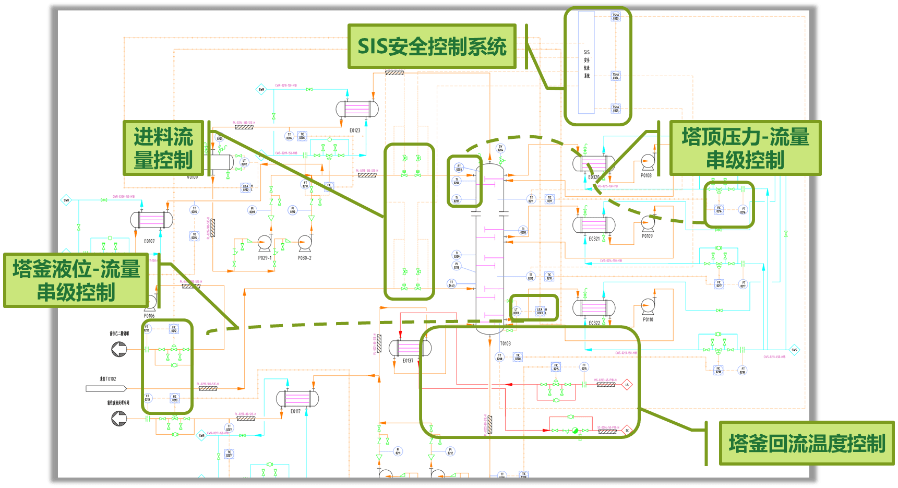
厂区车间三维图
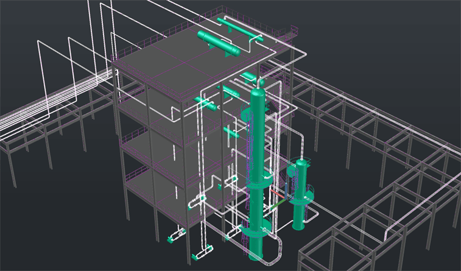
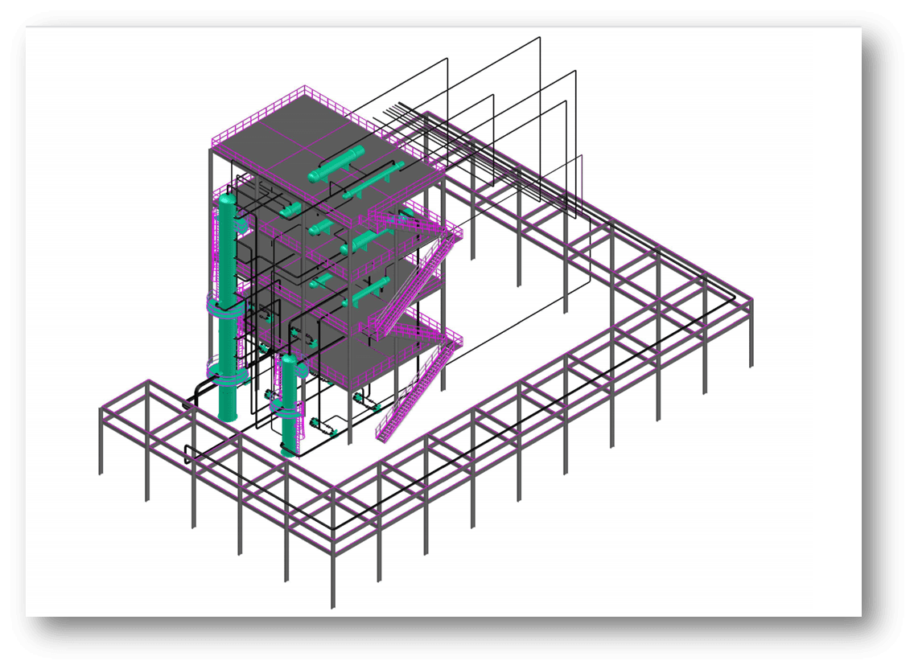
厂区布置图
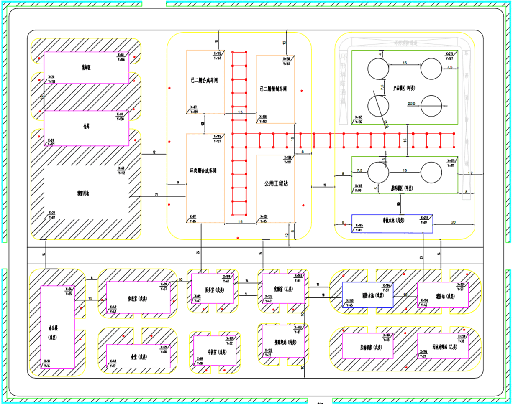
厂区三维布置图
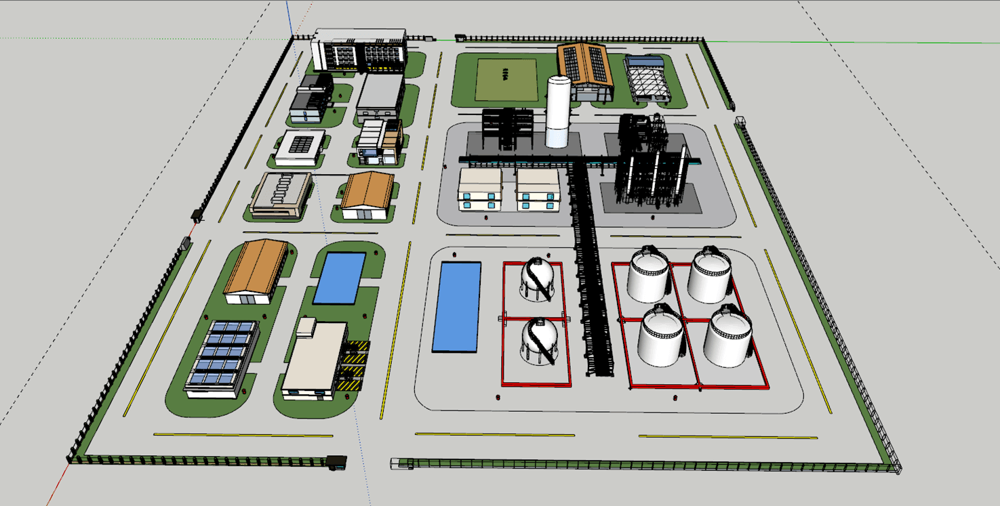
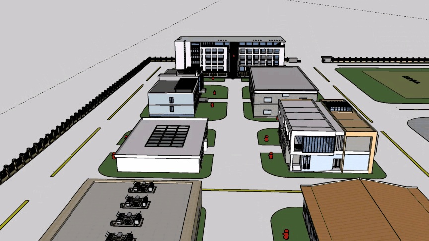
四月五月我参加了三次数学建模竞赛，六月参加化工实验大赛校内选拔赛，月底参加专题培训，时间过得很快，不知不觉就到了七月。7.20 是华中赛区提交作品截止期，我们在化工实验大赛华东区赛结束后，紧赶慢赶终于在 7.18 下午提交作品。七月底，评委初审给出华中赛区校赛结果，我们团队成为安理工校赛第一，成功出圈，按阿 C 画出的大饼，我们可以保底国二。九江之旅迫在眉睫，我们刚刚在上海结束化工实验大赛华东区赛，精力憔悴之余还得对付化工设计竞赛，制作团队展板。八月初，我们团队在九江学院参加本次化工设计竞赛华中赛区答辩，我表现比较并比较差，在最终答辩时刻没有吱声，仅有阿 C 舌战群儒答而不辩。最终稳拿国二结束本次比赛，值得一提的是，比赛期间我们在得知晋级国赛无望之后组团前去爬庐山，倒是别有一番风味。
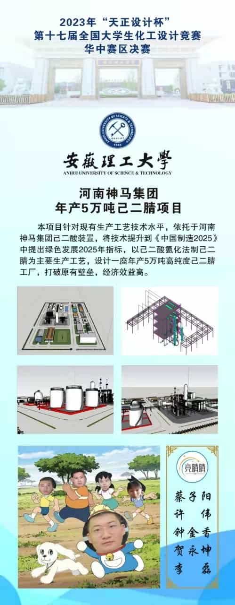
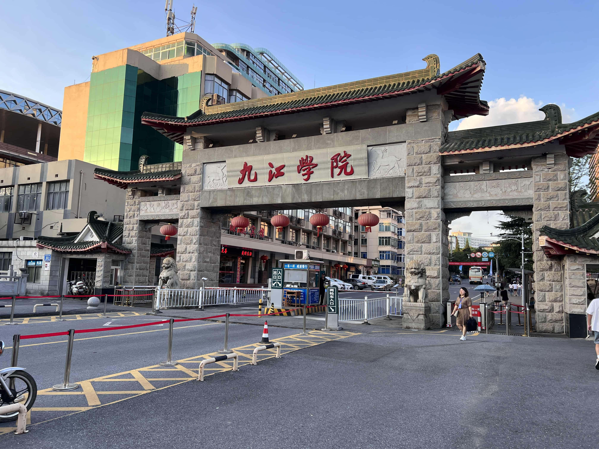
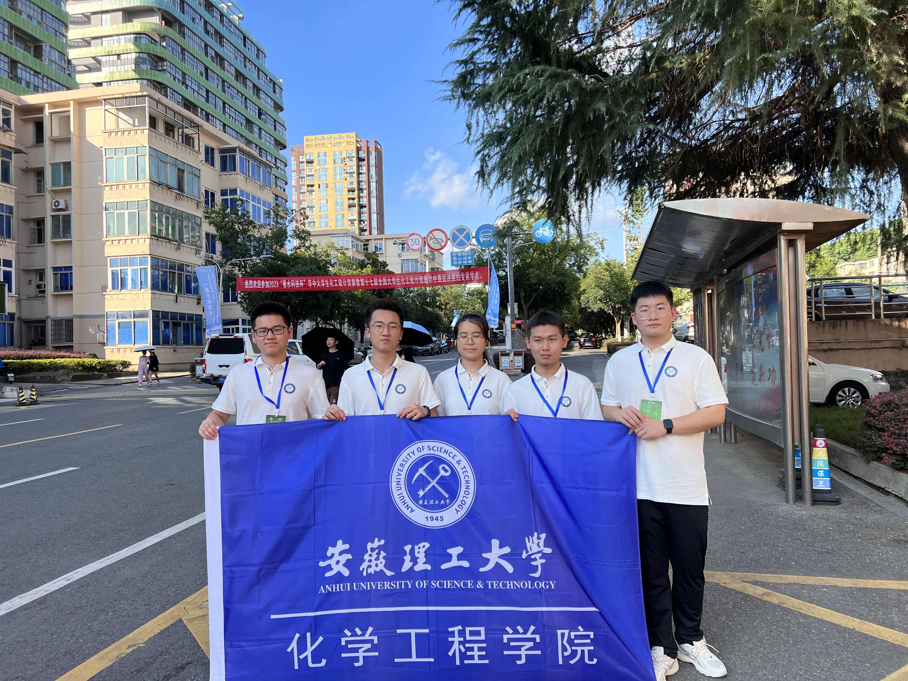
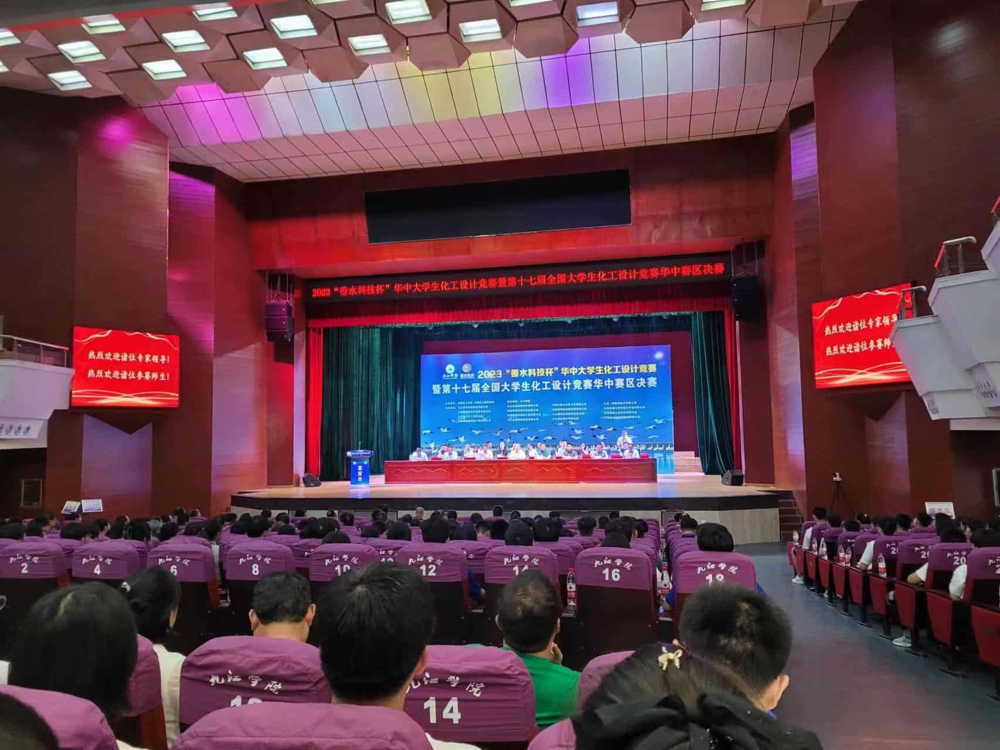
最后展示结果：我们团队获得全国二等奖的成绩。
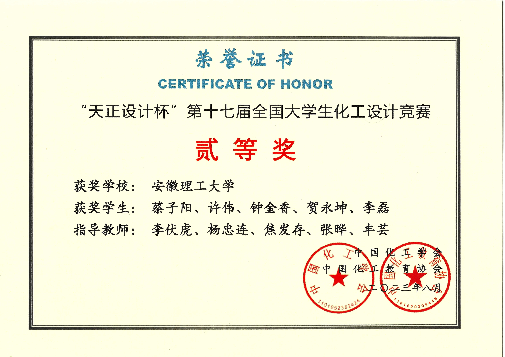

202610310946 写于北洋园格园二斋 128

